# Bauanleitung Meriva Küchenboxen

Zwei Schubladenboxen aus 10 mm Pappelsperrholz für den Kofferraum des Opel Meriva A.
Box 1 nutzt die volle Tiefe, Box 2 ist kürzer, damit die Kühlbox dahinter an der Rücklehne Platz hat.
Beide sind 48 cm breit und lassen sich stapeln.

| | Box 1 | Box 2 |
|---|---|---|
| Außenmaß (T × B × H) | 750 × 480 × 300 mm | 420 × 480 × 300 mm |
| Vollauszug | 700 mm, 45 kg, 12,7 mm | 350 mm, 45 kg, 12,7 mm |
| Gewicht leer | ca. 11 kg | ca. 7 kg |

**Inhalt:** [Einkaufsliste](#einkaufsliste) · [Zuschnitt](#zuschnitt) · [Querschnitt](#querschnitt-von-vorn) · [Schablonen](#schablonen) · [Aufbau](#aufbau) · [Im Kofferraum](#im-kofferraum)

---

## Einkaufsliste

- [ ] **Pappelsperrholz 10 mm**, Zuschnitt laut Tabelle (Hornbach), beide Boxen in einer Bestellung, 22 Teile · *ca. 102 €*
- [ ] **Vollauszug mit Selbsteinzug, 45 kg, 700 mm** für Box 1 · *1 Paar*
- [ ] **Vollauszug mit Selbsteinzug, 45 kg, 350 mm** für Box 2, gleiches Modell · *1 Paar*
- [ ] **Buche-Leimholz 18 mm, Zuschnitt 434 × 233** für das Brett, passt auf beide Schubladen. Faser entlang der 434 mm · *1 Stk*
- [ ] **Quadratstab Kiefer 14 × 14 mm** (Hornbach, Konsta), ca. 9,9 m Bedarf · *6 × 2 m*
- [ ] **Holzleim D3**, wasserfest · *250–500 g*
- [ ] **Senkkopfschrauben 3,5 × 20**: Platte in Leiste, Schubladenboden · *200 Stk*
- [ ] **Senkkopfschrauben 3,5 × 18**: Blende von innen durch das Stirnteil · *20 Stk*
- [ ] **Flachkopf- oder Linsenkopfschrauben 3,5 × 9 (max. 10)** für die Auszüge. Mitgelieferte Schrauben sind meist zu lang für 10 mm · *60 Stk*
- [ ] **Spanngurt 25 mm mit Klemmschloss** für Boxen, Schubladen und Kühlbox an den Zurrösen · *2 Stk*
- [ ] **Antirutschmatte** unter und zwischen die Boxen und in die Schubladen · *ca. 1 m*
- [ ] **Hartwachsöl oder Klarlack** (wasserbasiert), Pinsel · *0,75 l*
- [ ] **Schneidebrettöl oder Leinöl** (lebensmittelecht), nur für das Brett · *1 Fl.*
- [ ] **Schleifpapier** Körnung 120 und 180 · *je 2 Bogen*
- [ ] **Doppelseitiges Klebeband** zum Ausrichten der Blende · *1 Rolle*

**Werkzeug:** Akkuschrauber, Holzbohrer 2 und 3 mm, Kegelsenker, Feinsäge mit Gehrungslade für die Leisten, Stichsäge und Forstnerbohrer 25 mm für den Griff, 4–6 Zwingen, Anschlagwinkel, Zollstock, Bleistift.

---

## Zuschnitt

Pappelsperrholz 10 mm (Maße in mm, Länge × Breite). Als Tabelle auch in [`../zuschnitt.csv`](../zuschnitt.csv).

| Teil | Name | Box 1 | Box 2 | Stück je Box |
|---|---|---|---|---|
| **A** | Seitenteil | 740 × 300 | 410 × 300 | 2 |
| **B** | Boden / Deckel | 740 × 460 | 410 × 460 | 2 |
| **C** | Rückwand | 460 × 280 | 460 × 280 | 1 |
| **D** | Blende | 476 × 292 | 476 × 292 | 1 |
| **E** | Schubladenseite | 700 × 200 | 350 × 200 | 2 |
| **F** | Stirnteil | 414 × 200 | 414 × 200 | 2 |
| **G** | Schubladenboden | 434 × 700 | 434 × 350 | 1 |
| **H** | Brett, Buche-Leimholz 18 mm | 434 × 233 | – | 1 (für beide) |

### Leisten 14 × 14 (selbst ablängen)

| Teil | Wofür | Box 1 | Box 2 |
|---|---|---|---|
| **L1** | Längskanten oben und unten an den Seitenteilen | 4 × 730 | 4 × 400 |
| **L2** | Senkrecht hinten an den Seitenteilen (für die Rückwand) | 2 × 252 | 2 × 252 |
| **L3** | Quer hinten an Boden und Deckel, dazu eine Querleiste mittig unter dem Deckel | 3 × 432 | 3 × 432 |
| **L4** | Innenecken der Schublade | 4 × 200 | 4 × 200 |
| **L5** | Unter dem Brett, seitliche Führung | 2 × 233 (ein Brett für beide) | |

Aufteilung auf die 2-m-Stäbe:

| Stab | Stücke |
|---|---|
| 1 | 730 + 730 + 400 |
| 2 | 730 + 730 + 400 |
| 3 | 400 + 400 + 432 + 432 + 252 |
| 4 | 4 × 432 + 200 |
| 5 | 3 × 252 + 2 × 233 + 3 × 200 |
| 6 | 4 × 200 (Rest als Reserve) |

---

## Querschnitt von vorn

Box 1 und Box 2 haben denselben Querschnitt. Das Brett passt in beide Schubladen.

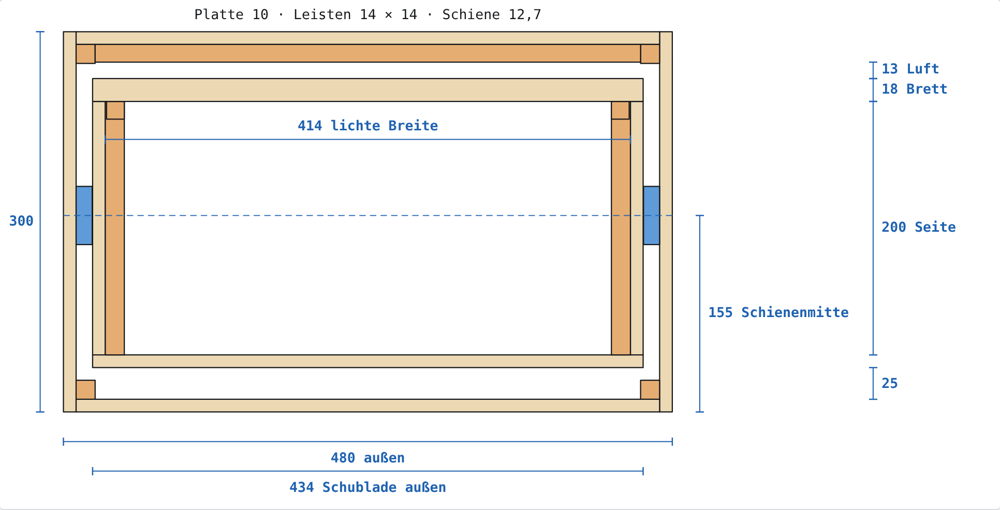

---

## Schablonen

3D-Druck-Schablonen aus [`../schablonen/`](../schablonen). Blau ist die Schablone, orange die Leiste, grau der Auszug.
Der Name ist die STL-Datei bzw. der Wert für `teil` in der OpenSCAD-Datei.

| | Schablone | Wofür | Schritt |
|---|---|---|---|
| 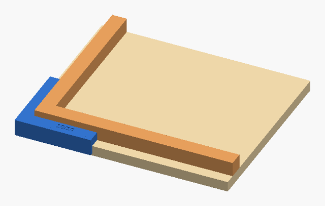 | **① Eckschablone 10/10** `eck_seite` | Hintere Ecken der Seitenteile, oben und unten. Hakt über beide Kanten. L1 und L2 einfach an die Stege legen. | 1 |
| 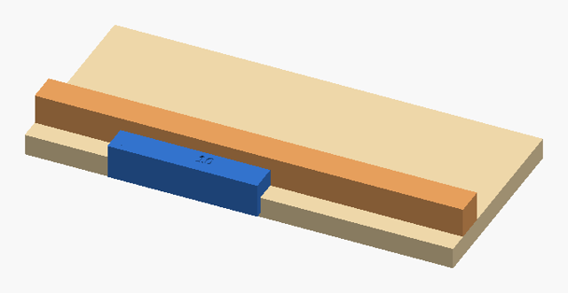 | **② Kantenschablone 10** `kante_10` | Vorderes Ende von L1. Hinten hält die Eckschablone, vorn diese, dann liegt die Leiste auf ganzer Länge 10 mm von der Kante. | 1 |
| 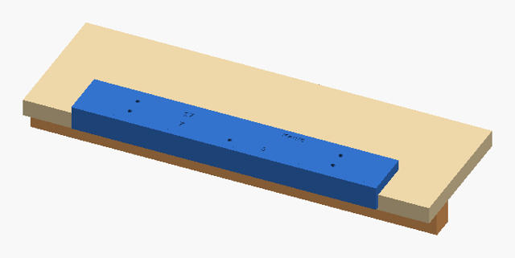 | **③ Bohrlehre 17 / 7 / 5** `bohrlehre` | An die Plattenkante hängen und mit 2 mm vorbohren. **17:** Platte in Leiste L1/L2/L3, Schubladenseite in L4 **7:** Boden, Deckel, Rückwand und Stirnteil **5:** Schubladenboden in die Kanten | 1, 3–6 |
| 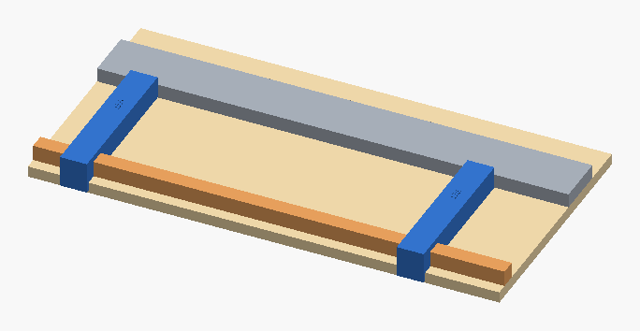 | **④ Schienenlehre 155** `schiene_korpus` | 2 Stück. Greift mit einem Kanal über die schon aufgeleimte L1 und hakt an der Unterkante des Seitenteils ein. Den Auszug mit seiner Unterkante anlegen. Die hintere Lehre nicht direkt an L2 setzen. | 2 |
| 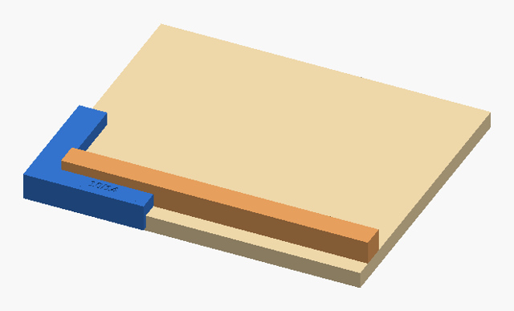 | **⑤ Eckschablone 10/14** `eck_boden` | Hintere Ecken von Boden und Deckel für L3: 10 mm von hinten, 14 mm von der Seite. | 3 |
| 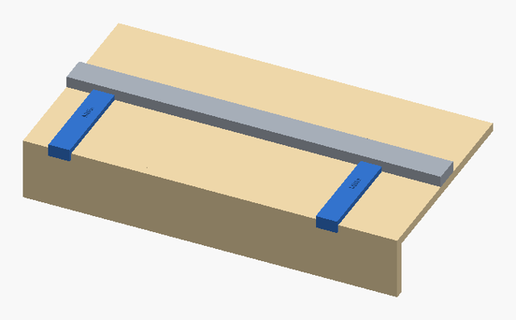 | **⑥ Schienenlehre 110** `schiene_schublade` | Anreißlehre, 2 Stück. Hakt unter dem Schubladenboden ein. Ihr Ende liegt genau auf der Schienenmitte (110 mm über der Seite, 120 mm ab Unterkante Boden). Strich ziehen, Schraubenlöcher der Innenschiene auf den Strich setzen. | 7 |
| 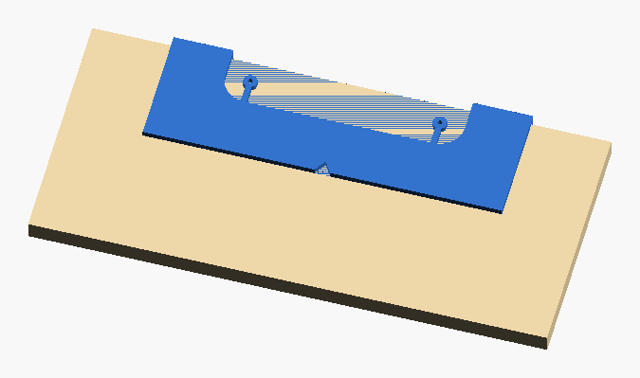 | **⑦ Griffschablone** `griff` | Über die Oberkante der Blende hängen, Kerbe auf die Mitte (238 mm) ausrichten, Ausschnitt umfahren. Die zwei Löcher sind die Ankörnpunkte für den 25-mm-Forstner. | 9 |
| 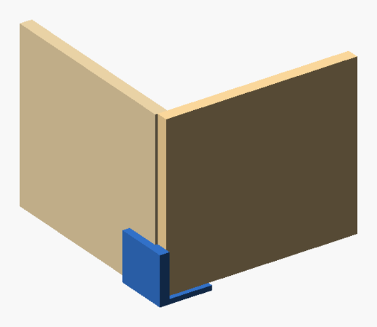 | **⑧ Blendenlehre links / rechts** `blende_links`, `blende_rechts` | Box steht auf dem Tisch. Die Blende steht auf dem 4-mm-Fuß und stößt an die 2-mm-Stufe. So stimmen die Fugen ohne Messen. | 9 |
| 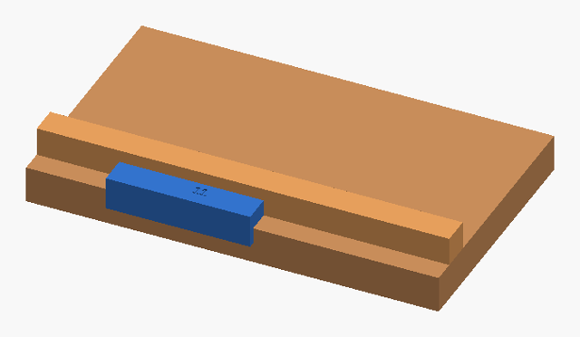 | **⑨ Kantenschablone 11** `kante_11` | Die beiden Führungsleisten L5 unter dem Brett, 11 mm von der langen Kante. | 10 |

---

## Aufbau

Die Zeichnungen zeigen Box 1. Box 2 baust du in denselben Schritten, nur kürzer (Maße in Klammern).

**Bohren:** Mit 2 mm durch Platte und Leiste vorbohren, dann das Loch in der Platte auf 3 mm aufweiten und ansenken. So zieht die Schraube die Platte fest an die Leiste. Leim und Schraube gehören zusammen. Setz die Schrauben ca. alle 12 cm und 3 cm von den Enden entfernt.

### 1. Leisten an die Seitenteile

> **Schablone:** ① Eckschablone 10/10 an beiden hinteren Ecken · ② Kantenschablone 10 am vorderen Ende von L1 · ③ Bohrlehre, Reihe 17

1. Auf beide Seitenteile **A** innen je zwei Leisten **L1** längs leimen, **10 mm** von der Ober- und Unterkante. In diesen Streifen sitzen später Boden und Deckel.
2. Vorn schließen die Leisten bündig ab, hinten bleiben 10 mm frei für die Rückwand.
3. Senkrecht dazwischen **L2** setzen, ebenfalls 10 mm von der Hinterkante.
4. Von außen durch die Platte in die Leiste schrauben (3,5 × 20). Das zweite Seitenteil baust du spiegelbildlich.

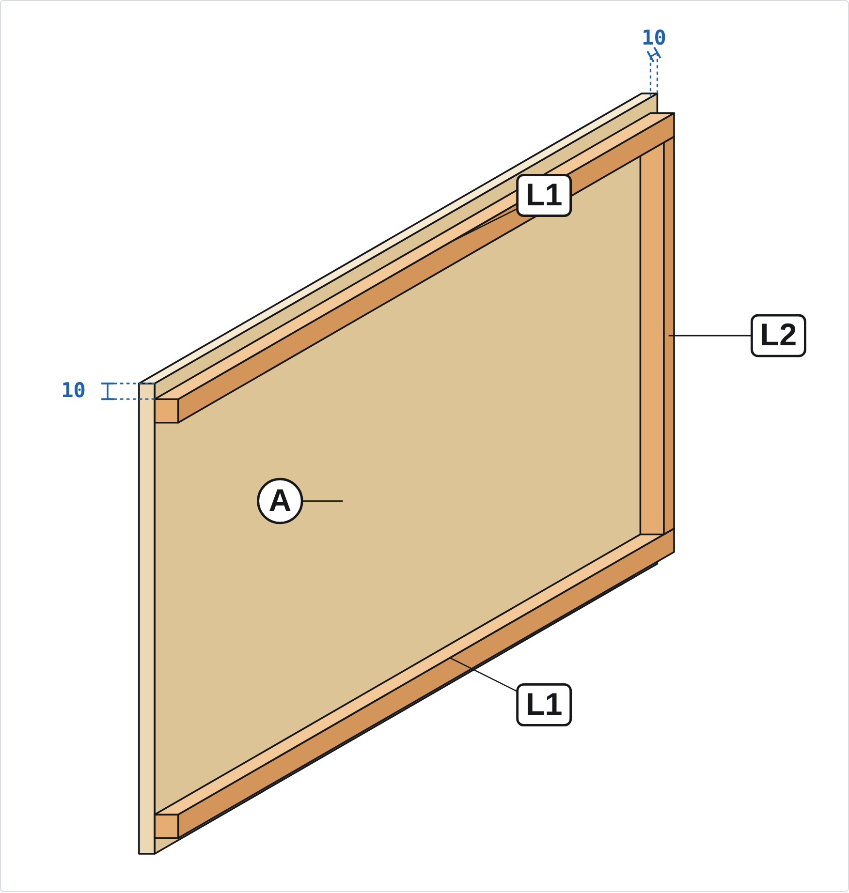

### 2. Korpusschienen montieren

> **Schablone:** ④ Schienenlehre 155, 2 Stück, vorn und hinten

1. Den Auszug auseinandernehmen: Die innere Schiene kommt an die Schublade, die äußere an den Korpus. Wie das geht, steht in der Anleitung des Auszugs, meist löst man sie mit einem Hebel.
2. Die Schiene liegt mit ihrer Mittellinie **155 mm** über der Unterkante des Seitenteils. Mit der Schienenlehre musst du nichts anreißen: Schiene mit der Unterkante an beide Lehren legen.
3. Die Schiene vorn bündig mit der Vorderkante ausrichten, zuerst durch die Langlöcher schrauben (3,5 × 9 Flachkopf), dann die runden Löcher setzen. Das Gleiche am zweiten Seitenteil.

So liegt die Schiene vor dem Zusammenbau flach auf dem Tisch. Das ist viel einfacher, als später in der Box zu schrauben.

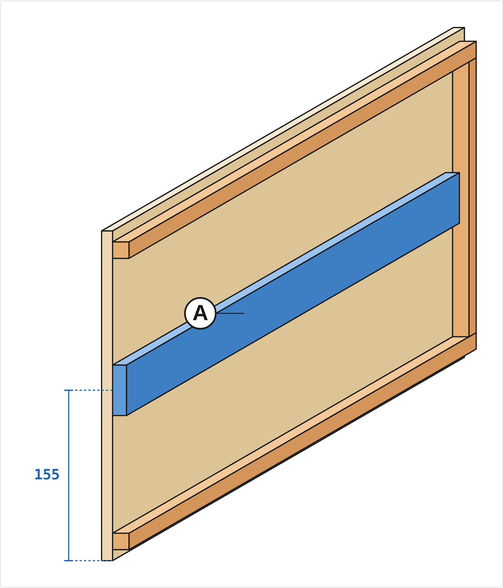

### 3. Leisten an Boden und Deckel

> **Schablone:** ⑤ Eckschablone 10/14 an beiden hinteren Ecken · ③ Bohrlehre, Reihe 17, von unten in L3

1. Auf den Boden **B** hinten eine Leiste **L3** quer leimen, 10 mm von der Hinterkante und mittig, sodass links und rechts je 14 mm frei bleiben (dort liegen die **L1**).
2. Beim Deckel genauso, dazu eine zweite **L3** quer in der Mitte: bei 358 mm von vorn (Box 2: 193 mm). Sie verhindert, dass der Deckel durchhängt, wenn Box 2 oder die Kühlbox darauf steht.

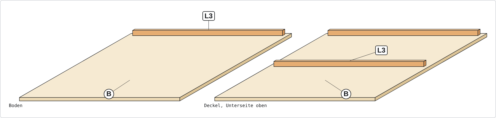

### 4. Korpus verschrauben

> **Schablone:** ③ Bohrlehre, Reihe 7

1. Den Boden zwischen die Seitenteile auf die unteren **L1** setzen, sodass die Unterkanten bündig sind. Von unten durch den Boden in die Leisten schrauben.
2. Den Deckel genauso von oben einsetzen und verschrauben. Die Senkköpfe müssen flächenbündig sitzen, damit Box 2 beim Stapeln plan aufliegt.
3. Mit dem Winkel prüfen, ob der Korpus rechtwinklig ist, bevor der Leim anzieht.

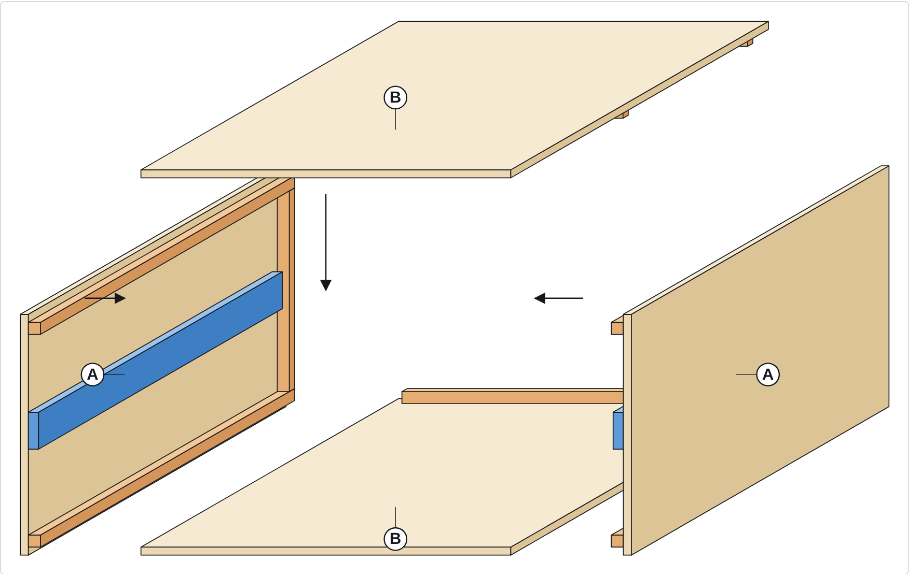

### 5. Rückwand einsetzen

> **Schablone:** ③ Bohrlehre, Reihe 7

1. Die Rückwand **C** hinten zwischen Seiten, Boden und Deckel einsetzen. Sie liegt an den Leisten **L2** und **L3** an und schließt bündig mit der Hinterkante ab.
2. Von hinten durch die Rückwand in die Leisten schrauben. Die Rückwand macht den Korpus endgültig steif.

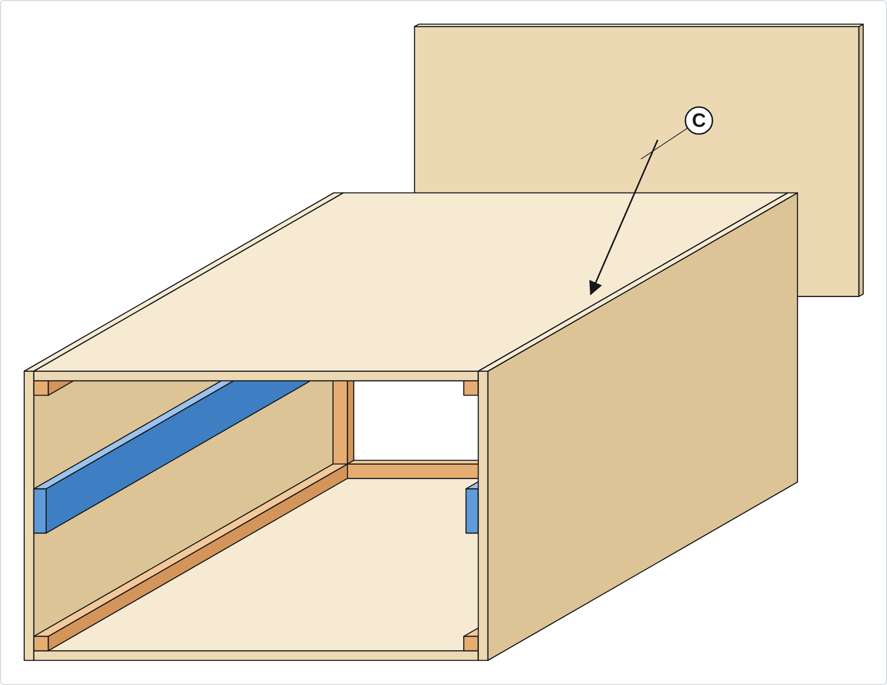

### 6. Schublade bauen

> **Schablone:** ③ Bohrlehre: Stirnteil 7 · Seite 17 · Boden 5

1. An beide Stirnteile **F** innen links und rechts je eine Leiste **L4** bündig leimen und schrauben.
2. Die Seiten **E** außen an die Stirnteile setzen und von außen in die **L4** schrauben. Außenmaß jetzt 434 mm.
3. Den Boden **G** **vollflächig** unter die Seiten und Stirnteile leimen, dann von unten in die Kanten schrauben (2 mm vorbohren, mittig in die 10-mm-Kante). Der Leim trägt, die Schrauben drücken nur an. Akkuschrauber auf kleines Drehmoment stellen, damit die Pappelkante nicht aufspaltet.
4. Diagonalen messen: Sind beide gleich lang, ist die Schublade rechtwinklig.

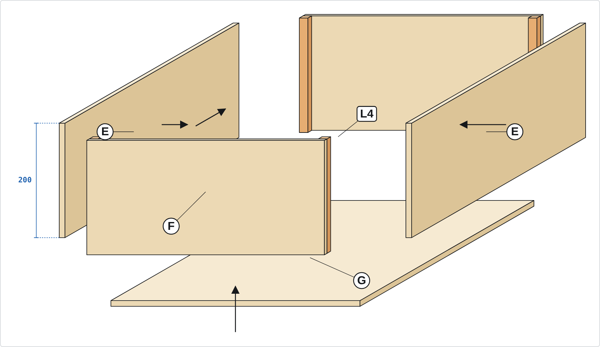

### 7. Schienen an die Schublade

> **Schablone:** ⑥ Schienenlehre 110, 2 Stück, vorn und hinten

1. Die Mittellinie der Schiene liegt **110 mm** über der Unterkante der Schubladenseite (ohne den Boden darunter), also 10 mm über der Mitte der Seite. Das ist Absicht, so passt sie zur Korpusschiene bei 155 mm.
2. Die Innenschiene ist schmaler als der ganze Auszug. Mit der Schienenlehre ⑥ ziehst du vorn und hinten einen Strich auf der Mittellinie und verbindest beide mit dem Lineal. Die Schraubenlöcher der Innenschiene liegen auf dieser Linie.
3. Schiene vorn bündig mit dem Stirnteil anschrauben (3,5 × 9 Flachkopf).
4. Rechnerisch läuft die Schublade dann 25 mm über dem Korpusboden.

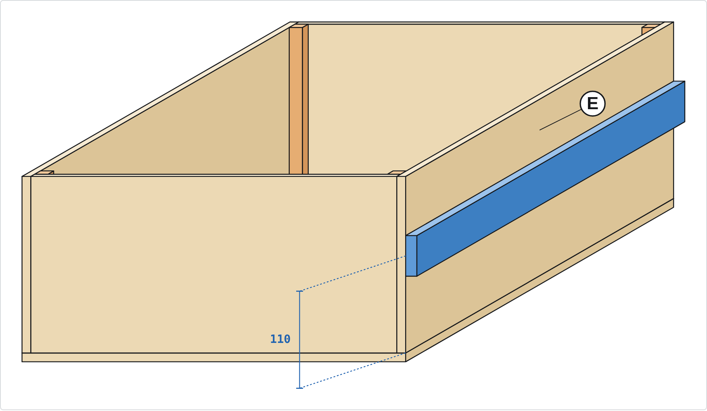

### 8. Schublade einsetzen

1. Die Schublade mit den inneren Schienen in die Korpusschienen einführen und gerade einschieben, bis sie einrastet.
2. Ein paarmal ganz aus- und einfahren. Klemmt sie, die Schrauben in den Langlöchern lösen und nachjustieren.
3. Zum Schluss alle runden Löcher verschrauben.

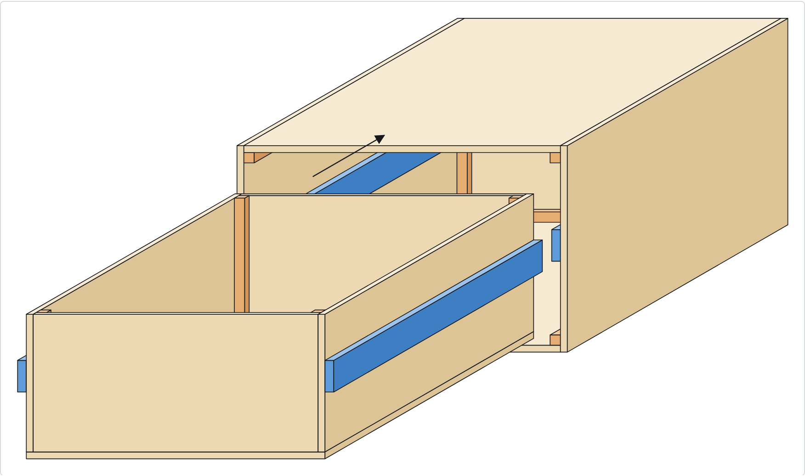

### 9. Blende und Griff

> **Schablone:** ⑦ Griffschablone zum Anzeichnen · ⑧ Blendenlehre links und rechts

1. In die Blende **D** oben mittig einen Griffausschnitt sägen: **120 mm breit, 25 mm tief**. Die Ecken mit dem 25-mm-Forstner rund bohren (die zwei Löcher der Griffschablone zeigen die Mittelpunkte zum Ankörnen), dazwischen mit der Stichsäge sägen und die Kanten gut verschleifen.
2. Doppelseitiges Klebeband auf das vordere Stirnteil kleben. Die Blende mit **2 mm** Fuge seitlich und **4 mm** zum Boden ausrichten und andrücken.
3. Schublade ausziehen und von innen durch das Stirnteil in die Blende schrauben (6–8 × 3,5 × 18). Wenn die Fugen stimmen, die Blende noch einmal lösen, Leim aufs Stirnteil geben und wieder anschrauben.

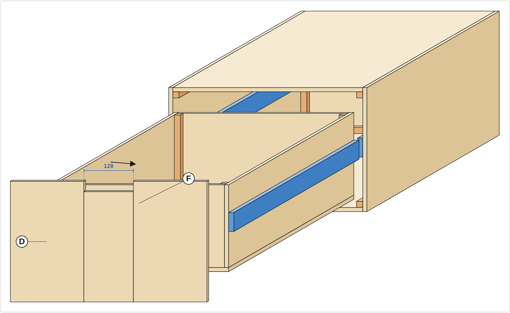

### 10. Brett

> **Schablone:** ⑨ Kantenschablone 11 für beide Leisten L5

1. Unter das Brett **H** zwei Leisten **L5** leimen, parallel zu den kurzen Kanten des Brettes, also in Schubladenlänge. Abstand von der langen Seitenkante jeweils **11 mm**: 10 mm für die Schubladenseite und 1 mm Luft.
2. Leim reicht, zwei Zwingen halten die Leisten, bis er trocken ist. Wenn du schrauben willst, nimm 3,5 × 25: 3,5 × 20 greifen nur 6 mm ins Brett.
3. Kanten rund schleifen und mit Schneidebrettöl mehrmals ölen, kein Lack.
4. Das Brett liegt auf den Seiten der Schublade und lässt sich längs schieben. Vorn und hinten stoppt es an den Eckleisten. Es passt in beide Schubladen.

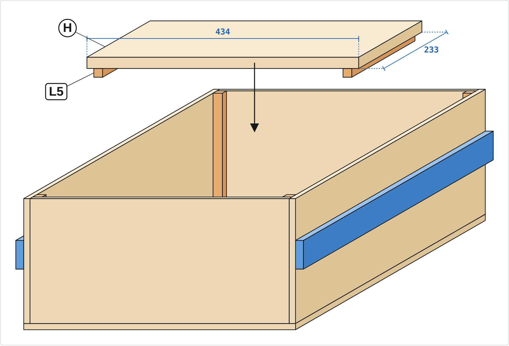

### 11. Schleifen und versiegeln

- Alle Kanten mit Körnung 120, dann 180 brechen und verschleifen.
- Zwei Schichten Hartwachsöl oder Klarlack, auch innen und auf den Unterseiten. So nimmt Pappel bei Feuchtigkeit kein Wasser auf.
- Antirutschmatte unter die Box legen, fertig. Box 2 genauso bauen.

---

## Im Kofferraum

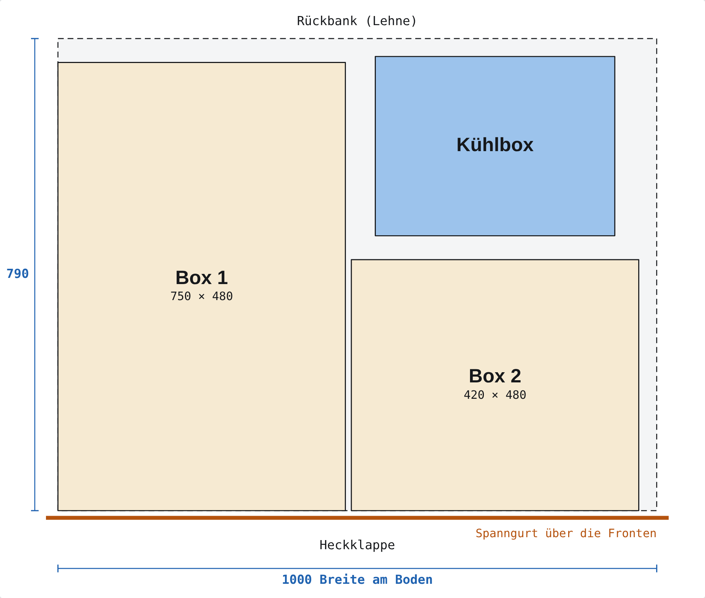

- Box 1 links, Box 2 rechts an der Heckklappe, die Kühlbox quer dahinter direkt an der Rücklehne (max. ca. 31 cm tief). Rechts bleiben ca. 3 cm für den Gurt.
- Ein Spanngurt läuft über die Fronten beider Boxen von Zurröse zu Zurröse. Er hält die Schubladen beim Fahren zu und die Boxen am Platz. Box 2 drückt die Kühlbox gegen die Lehne.
- Beide Schubladen sind jederzeit von der Heckklappe aus erreichbar. Die Kühlbox öffnest du von oben, über Box 2 hinweg.
- Gestapelt steht Box 2 auf Box 1, bündig zur Heckklappe, mit Antirutschmatte dazwischen. Dann muss der Gurt **über beide** Boxen laufen.
- Zum Kochen kommt der Kocher auf die voll ausgezogene Schublade von Box 1, außerhalb des Autos. Nicht aufstützen. Für schwere Töpfe ein Teleskopbein unter die Schubladenfront stecken; das Loch im Schubladenboden mit einem aufgeleimten Reststück (ca. 8 × 8 cm) verstärken.
